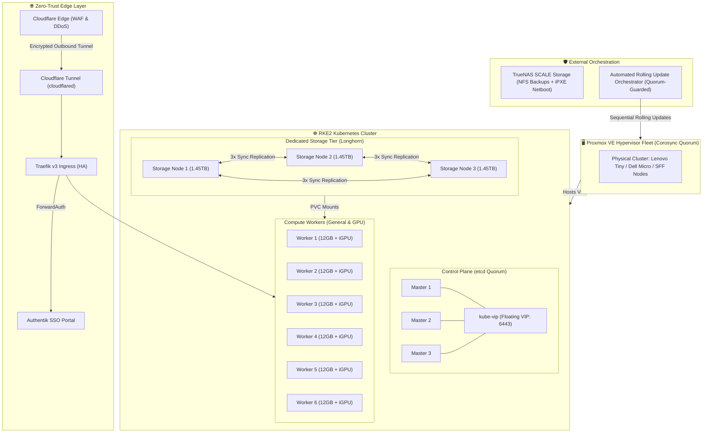

# 🌐 Enterprise Homelab & GitOps Reference Architecture

[](https://github.com/thaleus1)
[](https://docs.rke2.io/)
[](https://proxmox.com/)
[](https://opentofu.org/)
[](https://fleet.rancher.io/)
[](https://longhorn.io/)
[](https://goauthentik.io/)
[](https://www.gnu.org/licenses/gpl-3.0)

Welcome to **tn-homelab-howto**. This repository provides a complete, publication-grade reference architecture, Infrastructure as Code (IaC) suite, and GitOps template for building an enterprise-grade private cloud and homelab.

Designed and engineered by **Ryan Watson** ([`@thaleus1`](https://github.com/thaleus1)), this blueprint combines:
* **Hypervisor Lifecycle Automation**: Multi-node Proxmox VE clustering, zero-touch network PXE boot via TrueNAS iPXE, and quorum-aware automated rolling updates.
* **Declarative Infrastructure as Code**: Parallel VM provisioning across hypervisors using OpenTofu (`bpg/proxmox`).
* **High-Availability Kubernetes**: RKE2 with a floating Virtual IP (`kube-vip`) across 3 etcd masters.
* **Isolated Storage & Compute**: Dedicated 3-way replicated block storage tier (Longhorn) separated from compute workers, preventing replica rebuilding during maintenance.
* **Hardware-Accelerated Transcoding**: Intel QuickSync iGPU PCIe pass-through mapped cluster-wide for Plex and Jellyfin.
* **Zero-Trust Perimeter**: Cloudflare outbound tunnels, Let's Encrypt wildcard TLS, and Authentik Single Sign-On with Traefik ForwardAuth.
* **Zero-Secret Commits**: Dynamic secret pulling via External Secrets Operator and Bitwarden Secrets Manager.

---

## 🏛️ Architecture Overview



---

## 📚 Documentation & Runbooks

Start here to explore the design or build your own version:

| Guide | Description |
| :--- | :--- |
| 📖 **[Architecture Reference](docs/ARCHITECTURE.md)** | Full multi-tier design, separation of storage and compute, and ingress flows. |
| 🖥️ **[Hardware & Network Sizing](docs/HARDWARE_AND_NETWORK.md)** | 1L Tiny PC hardware recommendations, VLAN segmentation, and subnets. |
| 🌐 **[Automated PXE Network Boot](docs/PXE_NETWORK_BOOT.md)** | TrueNAS iPXE (`netboot.xyz`) and Proxmox automated `answer.toml` installation. |
| 🔄 **[Proxmox Automated Rolling Updates](docs/PROXMOX_AUTOMATION.md)** | Standalone, quorum-guarded hypervisor update orchestrator and cron setup. |
| 🛠️ **[Cluster Bootstrapping & VIP](docs/CLUSTER_BOOTSTRAP.md)** | Day-0 RKE2 initialization, `kube-vip` HA VIP, and agent joins. |
| 🔐 **[Secrets Management (Bitwarden + ESO)](docs/SECRETS_MANAGEMENT.md)** | Declarative secret synchronization using External Secrets Operator. |
| 🔒 **[SSO & Ingress Authentication](docs/AUTHENTICATION_SSO.md)** | Authentik single sign-on, Traefik ForwardAuth, and Cloudflare Tunnels. |
| 🚨 **[Disaster Recovery Runbook](docs/DISASTER_RECOVERY.md)** | Cold-start disaster recovery guide to rebuild from scratch. |
| ⚡ **[Power Maintenance & Cold-Start](docs/POWER_MAINTENANCE.md)** | Graceful shutdown hierarchy and orderly startup sequencing for physical power maintenance. |

---

## 📂 Repository Layout

```text
tn-homelab-howto/
├── docs/                        # 📖 Comprehensive architecture, DR, and deployment runbooks
├── infra/                       # 🏗️ OpenTofu IaC suite to build VMs on Proxmox VE
│   ├── versions.tf, variables.tf# Provider and variable declarations
│   ├── cloud_init.tf            # Standard Ubuntu 24.04 cloud-init snippet
│   ├── vms_masters.tf           # 3 Control-plane master VMs (etcd quorum)
│   ├── vms_storage.tf           # 3 Dedicated Longhorn storage VMs (1.45TB NVMe disks)
│   ├── vms_workers.tf           # 6 Compute worker VMs (with PCIe GPU pass-through)
│   ├── terraform.tfvars.example # Turnkey example variables file
│   ├── scripts/                 # 🤖 Hypervisor lifecycle automation
│   │   └── pve_rolling_update.py# Quorum-guarded Proxmox rolling update orchestrator
│   └── pxe/                     # 🌐 Unattended bare-metal network boot automation
│       ├── custom.ipxe          # netboot.xyz custom menu
│       ├── answer.toml.example  # Automated installer answer file (SATA / sda)
│       └── first-boot.sh        # First-boot cluster join & NFS mount script
│
├── bootstrap/                   # 🛠️ Day-0 cluster bootstrapping & VIP configuration
│   ├── kube-vip.yaml            # High-availability Control Plane VIP (10.90.16.50:6443)
│   ├── rke2-server-config.yaml  # Template /etc/rancher/rke2/config.yaml for master nodes
│   └── rke2-agent-config.yaml   # Template /etc/rancher/rke2/config.yaml for workers/storage
│
├── platform/                    # ⚓ Foundational platform services
│   ├── metallb/                 # Layer-2 LoadBalancer IP address pool
│   ├── cert-manager/            # Let's Encrypt DNS-01 ACME wildcard certificates
│   ├── external-secrets/        # Bitwarden Secrets Manager integration
│   ├── cloudflare/              # Outbound Cloudflare Tunnel connector deployment
│   ├── traefik/                 # Traefik v3 Helm values and TLS store
│   ├── authentik/               # Authentik SSO values & ForwardAuth middleware
│   └── lifecycle/               # SUC rolling K8s upgrade plans & Kured reboot windows
│
└── apps/                        # 📦 Curated application manifests
    ├── media/                   # Plex & Jellyfin (Intel QuickSync hardware acceleration)
    ├── arr-stack/               # Sonarr, Radarr, Prowlarr, Bazarr, Lidarr, Cleanuparr
    ├── downloaders/             # qBittorrent + Gluetun VPN killswitch, SABnzbd
    ├── databases/               # CloudNative-PG high-availability PostgreSQL cluster
    ├── utilities/               # Home Assistant, Uptime Kuma, GitLab CE, OnlyOffice, OwnCloud
    └── portal/                  # Unified zero-trust homelab web portal
```

---

## 🚀 Quickstart: Recreating This Architecture

1. **Hardware & Network**: Follow [`docs/HARDWARE_AND_NETWORK.md`](docs/HARDWARE_AND_NETWORK.md) to set up your VLANs and physical cabling.
2. **PXE Network Boot**: Deploy [`docs/PXE_NETWORK_BOOT.md`](docs/PXE_NETWORK_BOOT.md) to automatically install Proxmox VE onto your bare-metal machines.
3. **Provision Virtual Machines**:
   ```bash
   cd infra/
   cp terraform.tfvars.example terraform.tfvars
   # Fill in your Proxmox API token and SSH public key
   tofu init
   tofu apply
   ```
4. **Bootstrap Control Plane**:
   * Follow [`docs/CLUSTER_BOOTSTRAP.md`](docs/CLUSTER_BOOTSTRAP.md) to initialize Master 1 and deploy `bootstrap/kube-vip.yaml`.
   * Join remaining masters, storage nodes, and worker nodes to the Virtual IP.
5. **Deploy Platform & GitOps**:
   * Deploy MetalLB, Cert-Manager, Bitwarden ESO, and Traefik.
   * Connect Rancher Fleet (`fleet.yaml`) to automatically deploy and manage all applications.

---

## 👤 Author & Maintainer

* **Author & Architect**: **Ryan Watson**
* **GitHub**: [@thaleus1](https://github.com/thaleus1)

---

## 📄 License

This project is licensed under the **GNU General Public License v3.0** — see the [LICENSE](LICENSE) file for details.
