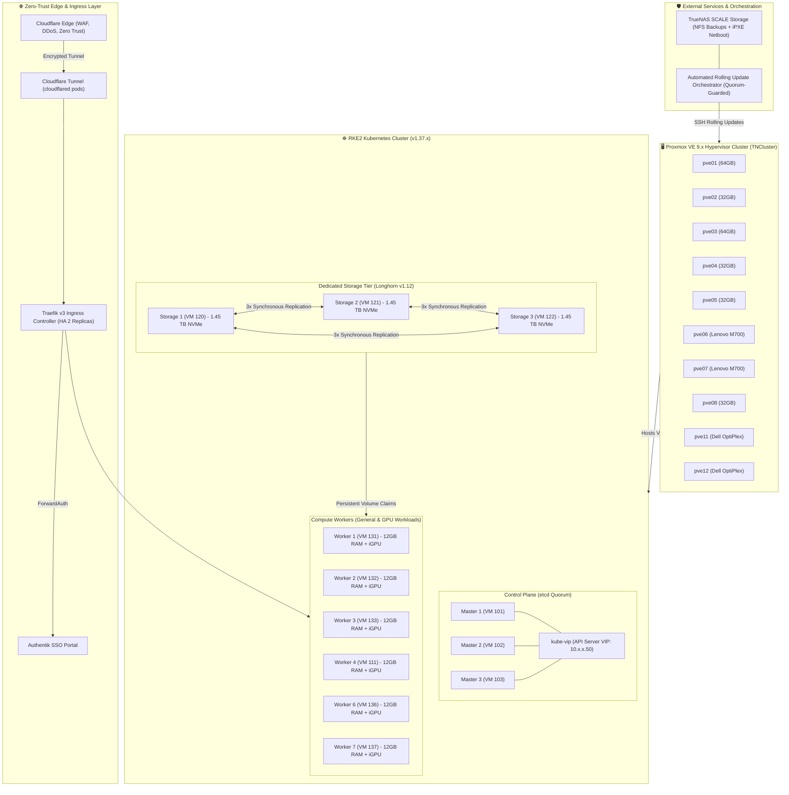

# 🌐 Enterprise Homelab Architecture Blueprint

**Author:** Ryan Watson ([@thaleus1](https://github.com/thaleus1))  
**Repository:** [tn-homelab-howto](https://github.com/thaleus1/tn-homelab-howto)

This document details the multi-tiered high-availability architecture powering this enterprise-grade homelab blueprint.

---

## 1. High-Level Architecture Diagram

---

## 2. Core Architectural Pillars

### 1. Complete Separation of Storage and Compute
In standard Kubernetes clusters, pods and persistent storage often share nodes. If a worker node crashes or reboots during maintenance, block storage replicas enter a degraded state and begin resynchronizing.
* **Our Solution**: We separate **Dedicated Storage Nodes** (`rke2-longhorn1,3,4`) from **Compute Workers** (`rke2-worker1..7`).
* Storage nodes run Longhorn replication engines on dedicated 1.45 TB NVMe virtual disks. General application workloads are tainted or disabled (`node-role.kubernetes.io/storage=true`).
* Compute worker nodes have storage scheduling **disabled** (`allowScheduling: false`). Worker nodes can reboot, drain, or crash without triggering replica rebuilds.

### 2. High Availability Control Plane with `kube-vip`
* Master nodes run an odd-numbered etcd cluster (3 nodes).
* `kube-vip` provides a floating virtual IP (e.g. `10.90.16.50:6443`) across all masters. Worker nodes and GitOps engines communicate exclusively through the VIP, preventing single-point failure during master maintenance.

### 3. Hypervisor Fleet with Corosync Quorum
* Proxmox VE hosts form an integrated cluster sharing storage (`TNBackups`), network bridges (`vmbr0`), and cluster-wide PCI device mappings.
* Corosync maintains cluster membership. A 10-node cluster requires $\ge 6$ votes for quorum.

### 4. Zero-Trust Edge Security
* Outbound-only Cloudflare Tunnels eliminate open inbound HTTP/S ports on the firewall.
* Traefik terminates traffic with Let's Encrypt wildcard certificates (`*.yourdomain.com`).
* Authentik provides central identity verification (OIDC / OAuth2 / ForwardAuth) with MFA enforcement.

### 5. Automated Hardware & OS Lifecycle
* **Bare-Metal Provisioning**: Unattended network boot via iPXE (`netboot.xyz`) and Proxmox automated answer files (`answer.toml`).
* **Hypervisor Updates**: Automated rolling update orchestrator hosted on TrueNAS, verifying cluster quorum before and after updating each hypervisor.
* **Kubernetes Node Upgrades**: System Upgrade Controller (SUC) for rolling RKE2 upgrades; Kured for guarded OS reboots between 02:00 and 05:00.
