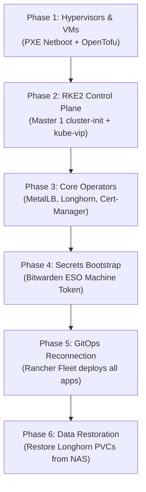

# 🚨 Disaster Recovery & Cold-Start Runbook

**Author:** Ryan Watson ([@thaleus1](https://github.com/thaleus1))  
**Repository:** [tn-homelab-howto](https://github.com/thaleus1/tn-homelab-howto)

This runbook outlines the step-by-step cold-start procedure to rebuild the entire enterprise homelab from scratch in the event of total hardware loss, disk corruption, or catastrophic datacenter failure.

---

## 1. Disaster Recovery Workflow



---

## 2. Phase-by-Phase Recovery Guide

### Phase 1: Hypervisor Fleet & Virtual Machine Provisioning
1. If hypervisors are wiped, netboot them using [`docs/PXE_NETWORK_BOOT.md`](PXE_NETWORK_BOOT.md).
2. Once Proxmox VE hypervisors form the cluster, run OpenTofu to provision all 12 VMs in parallel:
   ```bash
   cd infra/
   cp terraform.tfvars.example terraform.tfvars
   tofu init
   tofu apply
   ```

### Phase 2: RKE2 Cluster Bootstrap
1. SSH into `rke2-master1` and initialize the first control plane node.
2. Deploy `bootstrap/kube-vip.yaml` to establish the floating API Server VIP (`10.90.16.50:6443`).
3. Join `rke2-master2` and `rke2-master3` to complete the 3-node etcd quorum.
4. Join all storage and worker nodes following [`docs/CLUSTER_BOOTSTRAP.md`](CLUSTER_BOOTSTRAP.md).

### Phase 3: Core Platform Deployments
From your administrative workstation:
1. Deploy MetalLB:
   ```bash
   kubectl apply -f platform/metallb/
   ```
2. Deploy Cert-Manager and Cloudflare ClusterIssuer:
   ```bash
   kubectl apply -f platform/cert-manager/
   ```
3. Deploy Longhorn storage operator and configure dedicated storage nodes.

### Phase 4: Secrets Bootstrap
Inject the Bitwarden Access Token to re-enable dynamic secret pulling:
```bash
kubectl create secret generic bitwarden-access-token \
  -n external-secrets \
  --from-literal=token="<YOUR_BITWARDEN_ACCESS_TOKEN>"

kubectl apply -f platform/external-secrets/cluster-secret-store.yaml
```

### Phase 5: Reconnect Rancher Fleet (GitOps Engine)
Deploy the Fleet agent targeting this Git repository. Fleet will automatically reconcile and deploy all platform services, IngressRoutes, and applications.

### Phase 6: Restore Longhorn Persistent Data
1. In the Longhorn Web UI, set the external backup target (e.g. NFS on TrueNAS).
2. Select your persistent volume snapshots and click **Restore Latest Backup**.
3. Application pods will mount their restored volumes and return to full operation.
