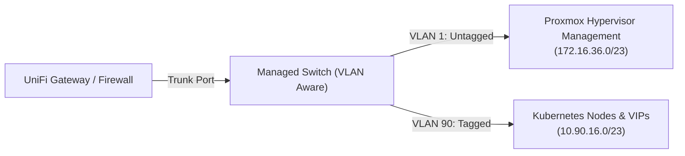

# 🖥️ Hardware & Network Architecture Guide

**Author:** Ryan Watson ([@thaleus1](https://github.com/thaleus1))  
**Repository:** [tn-homelab-howto](https://github.com/thaleus1/tn-homelab-howto)

This guide provides hardware recommendations, network topology design, VLAN segmentation rules, and physical cabling considerations for deploying this enterprise homelab.

---

## 1. Hardware Selection & Sizing

The architecture is optimized for 1-Liter "Project TinyMiniMicro" nodes (Lenovo ThinkCentre Tiny, Dell OptiPlex Micro, HP EliteDesk Mini) and Small Form Factor (SFF) desktop servers.

### Recommended Node Profiles

| Role | Form Factor | Recommended CPU | Recommended RAM | Storage Configuration |
| :--- | :--- | :--- | :--- | :--- |
| **Control Plane Masters** | SFF or Mini PC | 4+ Cores (Intel 6th+ Gen or AMD) | 16–32 GB | 256 GB+ SATA/NVMe SSD |
| **Dedicated Storage Nodes** | SFF Desktop | 4+ Cores (Intel / AMD) | 32–64 GB | 256 GB OS + **1.5+ TB NVMe** for Longhorn |
| **Compute Workers** | 1L Tiny PC | Intel 6th–12th Gen with iGPU | 16–32 GB | 256 GB+ NVMe SSD |

### Why Intel CPUs for Compute Workers?
Intel CPUs featuring **Intel QuickSync Video** (HD Graphics 530, 630, UHD 730/770) enable hardware-accelerated video transcoding for Plex, Jellyfin, and Tdarr without needing expensive or power-hungry dedicated PCIe graphics cards.

---

## 2. Hardware Caveats & Field Lessons

### Lenovo ThinkCentre Tiny & Dell Micro PXE Caveat
* Many 1L Mini PCs have an M.2 A+E key or PCIe riser supporting secondary 2.5 GbE NICs (e.g., Intel I225-V or I226-V).
* **Important**: Add-in PCIe network cards frequently lack an EFI PXE Option ROM.
* **Rule**: Always plug the network boot cable into the **onboard Ethernet port** (`eno1`, typically Intel I219-V) during initial network installation. Once Proxmox VE is installed, both onboard and PCIe NICs are fully supported by the Linux kernel.

---

## 3. Network Segmentation & VLAN Architecture

Separating administrative hypervisor traffic from containerized application workloads is critical for zero-trust security.

### Suggested Subnet Mapping

| VLAN | Network Name | Suggested Subnet | Purpose |
| :--- | :--- | :--- | :--- |
| **VLAN 1** | `Management` | `172.16.36.0/23` (or `192.168.1.0/24`) | Proxmox VE web GUI, Corosync cluster traffic, IPMI, TrueNAS management |
| **VLAN 90** | `Servers / K8s` | `10.90.16.0/23` (or `10.0.10.0/24`) | RKE2 nodes, Pod CIDRs, MetalLB VIP pool, Traefik ingress |

---

## 4. IP Allocation Reference Matrix

Customize these ranges in [`infra/terraform.tfvars.example`](../infra/terraform.tfvars.example) to match your environment:

### Kubernetes Subnet (`10.90.16.0/23`)

| IP Range | Assignment | Description |
| :--- | :--- | :--- |
| `10.90.16.1` | Default Gateway | UniFi CloudGateway / Router |
| `10.90.16.6` | `rke2-admin` | Management bastion / deployment workstation |
| `10.90.16.41 - .43` | Masters (`rke2-master1..3`) | RKE2 control plane master VMs |
| `10.90.16.46, .48, .52`| Storage (`rke2-longhorn1,3,4`) | Dedicated Longhorn replica storage VMs |
| `10.90.16.44 - .54` | Workers (`rke2-worker1..7`) | Virtualized compute worker VMs |
| **`10.90.16.50`** | **Control Plane VIP** | Floating `kube-vip` address for API server |
| **`10.90.16.60 - .70`**| **MetalLB VIP Pool** | LoadBalancer service addresses (Plex, Traefik, Jellyfin) |
