# ⚡ Blueprint: Homelab Graceful Power Maintenance & Cold-Start Runbook

**Author & Maintainer:** Ryan Watson ([@thaleus1](https://github.com/thaleus1))  
**Repository:** [tn-homelab-howto](https://github.com/thaleus1/tn-homelab-howto)

This guide documents the architecture, safety procedures, dependency hierarchy, automated orchestration scripts, and manual commands for performing routine electrical and power maintenance across a multi-node Kubernetes and Proxmox VE homelab.

---

## 1. Why Sequencing Matters in an Enterprise Homelab

In an enterprise-grade Kubernetes and hypervisor environment, simply pulling the plug or shutting down machines in arbitrary order introduces severe risks:

```mermaid
flowchart TD
    subgraph Shutdown["Graceful Shutdown Hierarchy (Top-Down)"]
        S1["1. Database & Workload Quiesce<br/>(Postgres HA Checkpoint, Buffer Flush)"]
        S2["2. Kubernetes Workers<br/>(Stop rke2-agent -> Pods evacuate -> Longhorn detaches)"]
        S3["3. Kubernetes Storage Nodes<br/>(Stop rke2-agent -> Longhorn instance managers halt)"]
        S4["4. Kubernetes Control Planes<br/>(Stop rke2-server -> etcd WAL cleanly flushed)"]
        S5["5. Proxmox Virtual Machines<br/>(qm shutdown in reverse boot order 5 -> 1)"]
        S6["6. Proxmox Hypervisors<br/>(Physical nodes, quorum-guarded)"]
        S7["7. Central Storage<br/>(ZFS pool sync & TrueNAS halt)"]
        S8["8. Core Network & UPS<br/>(Switches, Router/Gateway, PDUs)"]
        S1 --> S2 --> S3 --> S4 --> S5 --> S6 --> S7 --> S8
    end

    subgraph Startup["Cold-Start Boot Hierarchy (Bottom-Up)"]
        B1["1. Power & Network Infrastructure<br/>(UPS, PDUs, Switches, Gateway DHCP/VLANs)"]
        B2["2. Central Storage Server<br/>(TrueNAS -> ZFS Pools & NFS exports active)"]
        B3["3. Proxmox VE Hypervisors<br/>(Physical nodes power on -> Corosync Quorum formed)"]
        B4["4. Order 1: Control Plane Masters<br/>(rke2-master1..3 -> etcd quorum & API VIP)"]
        B5["5. Order 2: Storage Nodes<br/>(rke2-longhorn1..3 -> Longhorn 3x replicas online)"]
        B6["6. Order 3: Compute Workers<br/>(rke2-worker1..N -> iGPU devices advertise -> Pods attach PVCs)"]
        B7["7. Order 4 & 5: Management & Standalone VMs<br/>(Admin bastions, utility services)"]
        B1 --> B2 --> B3 --> B4 --> B5 --> B6 --> B7
    end
```



### Critical Failure Modes Prevented by Orderly Sequencing:
1. **Distributed Storage (Longhorn) Volume Corruption**:
   If hypervisors or storage nodes are halted while compute workers are running, pods lose underlying block storage mid-write. This results in filesystem corruption, orphaned mount locks, or broken replica metadata requiring lengthy rebuilds.
2. **NFS Kernel `D-State` Deadlocks**:
   If TrueNAS shuts down before client VMs unmount NFS shares, processes accessing `/mnt/*` enter an uninterruptible sleep state (`D` state in Linux kernel). Virtual machines will hang on shutdown and cannot even be terminated with `kill -9`.
3. **etcd Split-Brain & WAL Fragmentation**:
   Abruptly halting control plane nodes without `systemctl stop rke2-server` can leave etcd transaction write-ahead logs corrupted or inconsistent, preventing API server initialization on restart.
4. **Corosync Quorum Loss**:
   If Proxmox nodes are stopped erratically, the cluster can lose quorum, which makes `/etc/pve` (pmxcfs) read-only and halts further administrative operations.

---

## 2. Pre-Maintenance Checklist

Complete this checklist 15–30 minutes prior to initiating physical power shutdown:

* [ ] **Verify Longhorn Volume Health**: Confirm zero degraded volumes:
  ```bash
  kubectl get volumes.longhorn.io -n longhorn-system | grep -v healthy
  ```
* [ ] **Verify Proxmox Quorum**: Confirm all nodes are quorate:
  ```bash
  pvecm status
  ```
* [ ] **Verify TrueNAS ZFS Pools**: Confirm ZFS storage is operational:
  ```bash
  zpool status -x
  ```
* [ ] **Verify Cluster Backups**: Ensure recent Longhorn snapshots and Proxmox Backup Server (PBS) jobs have succeeded.
* [ ] **Notify Users**: Alert family/users of planned downtime for streaming services and internal apps.

---

## 3. Automated Graceful Shutdown (Python Orchestrator)

A single Python script can orchestrate the entire graceful shutdown with progress tracking and safety checks:

```bash
# Optional: Perform a dry-run first to simulate every step
python3 infra/scripts/homelab_graceful_shutdown.py --dry-run

# Execute full automated graceful shutdown
python3 infra/scripts/homelab_graceful_shutdown.py
```

### Script Execution Sequence:
1. **Pre-flight health checks**: Queries K8s API, Longhorn volume robustness, and Corosync quorum.
2. **Database quiesce**: Issues `CHECKPOINT;` to CloudNative-PG PostgreSQL clusters.
3. **K8s workers stop**: Stops `rke2-agent` across workers, allowing pods to terminate and Longhorn volumes to detach.
4. **K8s storage stop**: Stops `rke2-agent` on dedicated Longhorn storage nodes.
5. **K8s masters stop**: Sequentially stops `rke2-server` on control planes to cleanly flush etcd WALs.
6. **VM shutdown**: Issues `qm shutdown` across all VMs in reverse boot order (5 down to 1), polling until stopped.
7. **Hypervisors poweroff**: Powers off Proxmox hypervisors safely.
8. **TrueNAS poweroff**: Runs `zpool sync` and shuts down TrueNAS.

---

## 4. Cold-Start Startup Procedure (When Power is Restored)

When power maintenance is complete, restore power **strictly from the bottom up**:

### Phase 1: Core Power & Networking (0:00 - 3:00)
1. Turn on UPS units and main PDU breaker circuits.
2. Power on the **router/gateway** and core network switches.
3. **Wait 3 minutes**: Ensure VLAN routing, DHCP services, and DNS are fully established.

### Phase 2: Central Storage (TrueNAS) (3:00 - 5:00)
1. Power on **TrueNAS**.
2. **Wait 2 minutes**: Ensure all ZFS pools import cleanly and NFS shares are active before turning on hypervisors.
3. Verify reachability: `ping <truenas-ip>`.

### Phase 3: Proxmox VE Hypervisors (5:00 - 8:00)
1. Power on all physical Proxmox VE nodes.
2. Corosync cluster will automatically form quorum.
3. **Automated VM Sequencing**: Configure Proxmox startup orders so VMs boot automatically in sequence:
   * **Order 1 (up 60s)**: RKE2 Masters boot, initialize etcd quorum, and bind API VIP.
   * **Order 2 (up 60s)**: Storage Nodes boot, mount NVMe storage, and start Longhorn volume replica engines.
   * **Order 3 (up 30s)**: Compute Workers boot, join Kubernetes, advertise QuickSync GPUs, and attach volumes.
   * **Order 4 & 5 (up 30s / 0s)**: Management and standalone application VMs power on.

---

## 5. Automated Post-Maintenance Verification

Once all physical machines have booted (approx. 8–10 minutes after initial power restoration), run the verification dashboard:

```bash
python3 infra/scripts/homelab_startup_verification.py
```

This verifies gateways, TrueNAS ZFS and NFS, Proxmox quorum, all 18 VMs running, 12 K8s nodes Ready, Longhorn volume robustness, Intel QuickSync iGPU allocations, MetalLB VIPs, and GitOps sync status.

---

## 6. Declarative Proxmox Startup Orders

Configure startup ordering on Proxmox VMs via `qm set <vmid> --startup order=X,up=Y`:

| Order | Up Delay | Target Workload / VMs | Purpose |
| :---: | :---: | :--- | :--- |
| **1** | `60s` | `rke2-master1..3` | Establishes etcd quorum and brings up `kube-vip` API VIP. |
| **2** | `60s` | `rke2-longhorn1..3` | Mounts replicated NVMe storage and initializes Longhorn volume engine. |
| **3** | `30s` | `rke2-worker1..N` | Workers join, advertise Intel QuickSync iGPU, and mount volumes. |
| **4** | `30s` | Bastion & Admin VMs | Administration and cluster jumpbox utilities. |
| **5** | `0s` | Standalone App VMs | Secondary services and standalone Docker containers. |
