# ⚡ ThaleusNet: Graceful Power Maintenance & Cold-Start Runbook

**Author & Maintainer:** Ryan Watson ([@thaleus1](https://github.com/thaleus1))  
**Network & Domain:** ThaleusNet ([thaleus.net](https://thaleus.net))

This runbook documents the complete architecture, safety procedures, dependency hierarchy, automated orchestration scripts, and manual fallback commands for performing routine electrical and power maintenance across the entire **ThaleusNet** homelab private cloud.

---

## 1. Executive Summary & System Overview

ThaleusNet comprises a tightly integrated multi-tier enterprise architecture:
* **Network & Gateway Tier**: UniFi CloudGateway Fiber (`10.90.16.1` / `172.16.37.254`), 10GbE SFP+ Aggregation, and PoE switches.
* **Central Storage Tier**: TrueNAS SCALE `jupiter` (`172.16.36.10`) hosting ZFS pools (`intstore1`, `IntStore2`, `Ext4Bay2`) and multi-path NFS exports.
* **Hypervisor Tier (`TNCluster`)**: 10 physical Proxmox VE 9.x nodes in Corosync high availability ($\ge 6$ of 10 quorum votes required).
* **Virtual Machine Tier**: 18 active VMs (12 RKE2 Kubernetes nodes, 2 Bastion/Admin VMs, and 4 standalone application VMs).
* **Kubernetes Tier (`rke2-fleet`)**: RKE2 v1.37.2 HA cluster featuring:
  * 3 Control Plane Masters (etcd quorum & `kube-vip` at `10.90.16.50:6443`)
  * 3 Dedicated Storage Nodes (Longhorn v1.12 with 3x distributed block storage replication across NVMe)
  * 6 Compute Workers (Intel QuickSync iGPU passthrough for Plex, Jellyfin, and Tdarr transcoding)
  * Rancher Fleet GitOps engine continuously reconciling cluster manifests.

---

## 2. Why Shutdown & Startup Sequencing Matters

In an enterprise-grade Kubernetes and hypervisor environment, cutting power or shutting down machines in arbitrary order introduces severe risks:

```mermaid
flowchart TD
    subgraph Shutdown["Graceful Shutdown Hierarchy (Top-Down)"]
        S1["1. Database & Workload Quiesce<br/>(Postgres HA Checkpoint, Buffer Flush)"]
        S2["2. Kubernetes Workers<br/>(Stop rke2-agent -> Pods evacuate -> Longhorn detaches)"]
        S3["3. Kubernetes Storage Nodes<br/>(Stop rke2-agent -> Longhorn instance managers halt)"]
        S4["4. Kubernetes Control Planes<br/>(Stop rke2-server -> etcd WAL cleanly flushed)"]
        S5["5. Proxmox Virtual Machines<br/>(qm shutdown in reverse boot order 5 -> 1)"]
        S6["6. Proxmox Hypervisors<br/>(10 physical nodes, quorum-guarded)"]
        S7["7. Central Storage<br/>(ZFS pool sync & TrueNAS halt)"]
        S8["8. Core Network & UPS<br/>(Switches, UniFi Gateway, PDUs)"]
        S1 --> S2 --> S3 --> S4 --> S5 --> S6 --> S7 --> S8
    end

    subgraph Startup["Cold-Start Boot Hierarchy (Bottom-Up)"]
        B1["1. Power & Network Infrastructure<br/>(UPS, PDUs, Switches, Gateway DHCP/VLANs)"]
        B2["2. Central Storage Server<br/>(TrueNAS jupiter -> ZFS Pools & NFS exports active)"]
        B3["3. Proxmox VE Hypervisors<br/>(10 nodes power on -> Corosync Quorum >= 6 formed)"]
        B4["4. Order 1: Identity, Core DNS & Storage<br/>(Artemis BIND DNS, Juno DC1, Vulcan DC2, saturn TrueNAS)"]
        B5["5. Order 2: Control Plane Masters<br/>(rke2-master1..3 -> etcd quorum & kube-vip 10.90.16.50)"]
        B6["6. Order 3: Storage Nodes<br/>(rke2-longhorn1,3,4 -> Longhorn 3x replicas online)"]
        B7["7. Order 4: Compute Workers<br/>(rke2-worker1..7 -> iGPU devices advertise -> Pods attach PVCs)"]
        B8["8. Order 5: Management Administration Bastions<br/>(rke2-admin, rke2-winadmin)"]
        B1 --> B2 --> B3 --> B4 --> B5 --> B6 --> B7 --> B8
    end
```



### Critical Failure Modes Prevented by Orderly Sequencing:
1. **Longhorn Volume Corruption & Replica Desync**:
   If hypervisors or storage nodes are halted while compute workers are running, pods lose underlying block storage mid-write. This results in filesystem corruption, orphaned mount locks, or broken replica metadata requiring lengthy rebuilds.
2. **NFS Kernel `D-State` Deadlocks**:
   If TrueNAS `jupiter` shuts down before client VMs unmount NFS shares, processes accessing `/mnt/*` enter an uninterruptible sleep state (`D` state in Linux kernel). Virtual machines will hang on shutdown and cannot even be terminated with `kill -9`.
3. **etcd Split-Brain & WAL Fragmentation**:
   Abruptly halting control plane nodes without `systemctl stop rke2-server` can leave etcd transaction write-ahead logs corrupted or inconsistent, preventing API server initialization on restart.
4. **Corosync Quorum Loss**:
   If Proxmox nodes are stopped erratically, the cluster can lose quorum ($< 6$ votes), which makes `/etc/pve` (pmxcfs) read-only and halts further administrative operations.

---

## 3. Pre-Maintenance Checklist

Complete this checklist 15–30 minutes prior to initiating physical power shutdown:

* [ ] **Verify Longhorn Volume Health**: Confirm zero degraded volumes:
  ```bash
  kubectl get volumes.longhorn.io -n longhorn-system | grep -v healthy
  ```
* [ ] **Verify Proxmox Quorum**: Confirm all 10 nodes are quorate:
  ```bash
  ssh root@172.16.36.53 "pvecm status"
  ```
* [ ] **Verify TrueNAS ZFS Pools**: Confirm ZFS storage is operational:
  ```bash
  ssh root@172.16.36.10 "zpool status -x"
  ```
* [ ] **Verify Cluster Backups**: Ensure recent Longhorn snapshots and Proxmox Backup Server (PBS) jobs have succeeded.
* [ ] **Notify Users**: Alert family/users of planned downtime for streaming services (Plex, Jellyfin) and internal tools.

---

## 4. Automated Graceful Shutdown (Recommended)

An automated orchestration script handles all 7 shutdown phases with safety timeouts, verification loops, and colored progress indicators.

### Running the Orchestrator
Execute the script from your workstation, `rke2-admin`, or TrueNAS `jupiter`:

```bash
# Optional: Perform a dry-run first to simulate every step
python3 infra/scripts/homelab_graceful_shutdown.py --dry-run

# Execute full automated graceful shutdown
python3 infra/scripts/homelab_graceful_shutdown.py
```

### Available CLI Flags:
* `--dry-run`: Simulates every command without executing.
* `-y`, `--yes`: Skips the interactive confirmation prompt for automated scripts.
* `--skip-k8s`: Leaves Kubernetes services running (shuts down VMs directly).
* `--skip-vms`: Skips VM shutdown.
* `--skip-pve`: Stops VMs and storage, but leaves physical Proxmox hosts running.
* `--skip-truenas`: Leaves TrueNAS `jupiter` running (useful for Proxmox-only maintenance).

> [!TIP]
> The script automatically writes detailed execution logs to:  
> `infra/logs/shutdown_YYYYMMDD_HHMMSS.log`

---

## 5. Manual Step-by-Step Shutdown Procedure

If running in an emergency or performing the shutdown manually without scripts, follow these exact steps in order:

### Step 1: Quiesce Databases & Workloads
Flush dirty database buffers and checkpoint the PostgreSQL HA cluster:
```bash
kubectl exec -n postgres postgres-ha-1 -c postgres -- psql -U postgres -c "CHECKPOINT;"
```

### Step 2: Stop Kubernetes Compute Workers
Log in to each of the 6 compute worker nodes and stop `rke2-agent`:
```bash
for ip in 10.90.16.44 10.90.16.45 10.90.16.49 10.90.16.51 10.90.16.53 10.90.16.54; do
  ssh root@$ip "systemctl stop rke2-agent.service" &
done
wait
```
*Wait 15–20 seconds for Longhorn volumes to detach cleanly.*

### Step 3: Stop Kubernetes Storage Tier
Stop `rke2-agent` on the 3 dedicated storage nodes:
```bash
for ip in 10.90.16.46 10.90.16.48 10.90.16.52; do
  ssh root@$ip "systemctl stop rke2-agent.service" &
done
wait
```

### Step 4: Stop Kubernetes Control Plane Masters
Stop `rke2-server` sequentially on masters to cleanly flush etcd:
```bash
ssh root@10.90.16.43 "systemctl stop rke2-server.service"  # rke2-master3
ssh root@10.90.16.42 "systemctl stop rke2-server.service"  # rke2-master2
ssh root@10.90.16.41 "systemctl stop rke2-server.service"  # rke2-master1
```

### Step 5: Shut Down Proxmox Virtual Machines
Execute VM shutdowns via Proxmox in reverse dependency order:
```bash
# Tier 5: Standalone VMs
ssh root@172.16.36.55 "qm shutdown 103"   # Artemis
ssh root@172.16.36.58 "qm shutdown 4101"  # Juno
ssh root@172.16.36.61 "qm shutdown 105"   # saturn-local
ssh root@172.16.36.61 "qm shutdown 115"   # Vulcan

# Tier 4: Management VMs
ssh root@172.16.36.62 "qm shutdown 106"   # rke2-winadmin
ssh root@172.16.36.53 "qm shutdown 114"   # rke2-admin

# Tier 3: Compute Workers
ssh root@172.16.36.57 "qm shutdown 137"   # rke2-worker7
ssh root@172.16.36.56 "qm shutdown 136"   # rke2-worker6
ssh root@172.16.36.61 "qm shutdown 111"   # rke2-worker4
ssh root@172.16.36.52 "qm shutdown 133"   # rke2-worker3
ssh root@172.16.36.51 "qm shutdown 132"   # rke2-worker2
ssh root@172.16.36.54 "qm shutdown 131"   # rke2-worker1

# Tier 2: Storage Nodes
ssh root@172.16.36.53 "qm shutdown 122"   # rke2-longhorn4
ssh root@172.16.36.61 "qm shutdown 104"   # rke2-longhorn3
ssh root@172.16.36.62 "qm shutdown 121"   # rke2-longhorn1

# Tier 1: Control Plane Masters
ssh root@172.16.36.62 "qm shutdown 118"   # rke2-master3
ssh root@172.16.36.55 "qm shutdown 101"   # rke2-master2
ssh root@172.16.36.61 "qm shutdown 100"   # rke2-master1
```
*Verify all VMs are powered off:*
```bash
ssh root@172.16.36.53 "pvesh get /cluster/resources --type vm --output-format json" | jq '.[] | select(.status=="running") | .name'
```

### Step 6: Power Off Proxmox Hypervisors
Power off the 10 Proxmox VE hypervisors:
```bash
for ip in 172.16.36.58 172.16.36.55 172.16.36.62 172.16.36.56 172.16.36.57 172.16.36.54 172.16.36.52 172.16.36.51 172.16.36.61 172.16.36.53; do
  ssh root@$ip "systemctl poweroff" &
done
```

### Step 7: Power Off Central Storage (TrueNAS)
Sync ZFS pools to disk and issue system halt on TrueNAS `jupiter`:
```bash
ssh root@172.16.36.10 "sync; zpool sync; systemctl poweroff"
```

### Step 8: Network & Power Infrastructure
* Power off UniFi Aggregation & PoE Switches.
* Power down UniFi CloudGateway Fiber router (`10.90.16.1`).
* Turn off PDU breakers and power down Uninterruptible Power Supplies (UPS).

---

## 6. Cold-Start Startup Procedure (When Power is Restored)

When power maintenance is complete, restore power **strictly from the bottom up**:

### Phase 1: Core Power & Networking (0:00 - 3:00)
1. Turn on UPS units and main PDU breaker circuits.
2. Power on the **UniFi CloudGateway Fiber** and core network switches.
3. **Wait 3 minutes**: Ensure VLAN 1 (`172.16.36.0/23`) and VLAN 90 (`10.90.16.0/23`) routing, DHCP services, and DNS are fully established.

### Phase 2: Central Storage (TrueNAS `jupiter`) (3:00 - 5:00)
1. Power on **TrueNAS SCALE `jupiter`** (`172.16.36.10`).
2. **Wait 2 minutes**: Ensure all ZFS pools (`intstore1`, `IntStore2`, `Ext4Bay2`) import cleanly and NFS shares are active before turning on hypervisors.
3. Verify from client: `ping 172.16.36.10`.

### Phase 3: Proxmox VE Hypervisors (5:00 - 8:00)
1. Power on all 10 Proxmox VE hosts (`pve01..08, 11, 12`).
2. Corosync cluster will automatically form quorum ($\ge 6$ votes).
3. **Automated VM Sequencing**: Because startup orders are configured in Proxmox, the hypervisors will automatically boot all active VMs in strict dependency order:
   * **Order 1 (up 30s)**: Identity, Core DNS & Media Storage (`Artemis` BIND DNS, `Juno` AD DC1, `Vulcan` AD DC2, `saturn-local` TrueNAS Storage) boot first so directory authentication, network DNS resolution, and Whisparr/Emby media shares are online.
   * **Order 2 (up 60s)**: RKE2 Masters (`rke2-master1..3`) boot, initialize etcd quorum, and bind API VIP `10.90.16.50`.
   * **Order 3 (up 60s)**: Storage Nodes (`rke2-longhorn1,3,4`) boot, mount local NVMe storage, and start Longhorn volume replica engines.
   * **Order 4 (up 30s)**: Compute Workers (`rke2-worker1..7`) boot, join Kubernetes, advertise QuickSync GPUs, and begin mounting Longhorn & NFS volumes.
   * **Order 5 (up  0s)**: Management bastions (`rke2-admin`, `rke2-winadmin`) power on.

---

## 7. Automated Post-Maintenance Verification

Once all physical machines have booted (approximately 8–10 minutes after initial power restoration), run the automated verification dashboard:

```bash
python3 infra/scripts/homelab_startup_verification.py
```

### What the Verification Script Validates:
1. **Network**: VLAN 90 & VLAN 1 gateways reachable (`10.90.16.1`, `172.16.37.254`).
2. **Storage**: TrueNAS `jupiter` ping, ZFS pool states, and NFS daemon active.
3. **Proxmox**: 10/10 physical hosts online, Corosync quorum healthy (10 votes).
4. **VM Fleet**: All 18 virtual machines confirmed `running`.
5. **Kubernetes**: API VIP `10.90.16.50:6443` responding, all 12 nodes `Ready`, zero crashing pods.
6. **Longhorn**: All 40 persistent volumes healthy (zero degraded).
7. **Hardware Transcoding**: All 6 compute workers advertising `gpu.intel.com/i915: 3`.
8. **MetalLB VIPs**: All 9 LoadBalancer IP addresses provisioned and mapped.
9. **GitOps**: Rancher Fleet `rke2-fleet` bundle `DEPLOYED: True` and monitored.

---

## 8. Declarative Proxmox Startup Orders

Startup sequencing is maintained declaratively across all 18 virtual machines:

| Order | Up Delay | Target Workload / VMs | Purpose |
| :---: | :---: | :--- | :--- |
| **1** | `60s` | `rke2-master1` (VM 100), `rke2-master2` (VM 101), `rke2-master3` (VM 118) | Establishes etcd quorum and brings up `kube-vip` API VIP (`10.90.16.50:6443`). |
| **2** | `60s` | `rke2-longhorn1` (VM 121), `rke2-longhorn3` (VM 104), `rke2-longhorn4` (VM 122) | Mounts replicated NVMe storage and initializes Longhorn volume engine. |
| **3** | `30s` | `rke2-worker1..4, 6, 7` (VMs 131, 132, 133, 111, 136, 137) | Workers join, advertise Intel QuickSync iGPU, and mount volumes. |
| **4** | `30s` | `rke2-admin` (VM 114), `rke2-winadmin` (VM 106) | Administration and cluster jumpbox utilities. |
| **5** | `0s` | `Artemis` (VM 103), `Juno` (VM 4101), `saturn-local` (VM 105), `Vulcan` (VM 115) | Standalone workloads and secondary services. |

To re-apply or synchronize boot orders across Proxmox at any time:
```bash
python3 infra/scripts/set_pve_boot_order.py
```

---

## 9. Troubleshooting & Disaster Recovery

### 1. Corosync Shows "Quorum: No" on Boot
* **Cause**: Fewer than 6 of 10 Proxmox nodes powered on or slow network switch port convergence.
* **Remedy**:
  1. Ensure physical network switches are fully booted.
  2. If some nodes are intentionally left powered off for maintenance, temporarily reduce expected votes on an active node:
     ```bash
     pvecm expected 1
     ```
  3. Once remaining nodes power on, Corosync will automatically synchronize.

### 2. Kubernetes Masters Show NotReady / etcd Quorum Missing
* **Cause**: Masters booted out of order or before network stabilized.
* **Remedy**:
  1. SSH to `rke2-master1` (`10.90.16.41`):
     ```bash
     systemctl restart rke2-server.service
     journalctl -u rke2-server -f
     ```
  2. Verify API VIP is bound: `ping 10.90.16.50`.

### 3. Longhorn Volume Stuck in "Attaching"
* **Cause**: Pod on worker node attempted attach before Longhorn storage replica node completed boot.
* **Remedy**:
  1. Verify storage node status: `kubectl get nodes -l node-role.kubernetes.io/storage=true`.
  2. Restart the affected pod to trigger a clean volume remount:
     ```bash
     kubectl delete pod <pod-name> -n <namespace>
     ```

### 4. NFS Volume Shows "Stale file handle"
* **Cause**: Worker node mounted TrueNAS NFS before TrueNAS finished exporting filesystems.
* **Remedy**:
  1. Verify TrueNAS NFS service: `ssh root@172.16.36.10 "systemctl status nfs-server"`.
  2. Delete the pod mounting the NFS share; Kubernetes will unmount the stale mount and re-acquire a fresh file handle.
