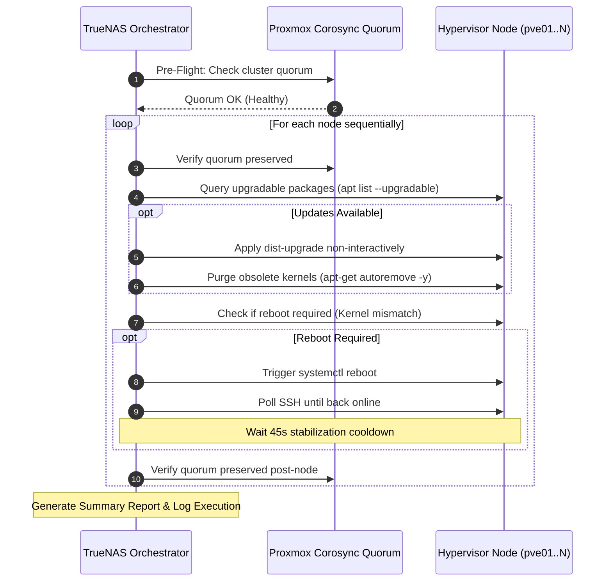

# 🔄 Proxmox VE Automated Rolling Updates Guide

**Author:** Ryan Watson ([@thaleus1](https://github.com/thaleus1))  
**Repository:** [tn-homelab-howto](https://github.com/thaleus1/tn-homelab-howto)

This guide documents the architecture, safety guards, and cron automation powering sequential, quorum-aware rolling updates across multi-node Proxmox VE clusters.

The standalone Python orchestrator script is available in [`infra/scripts/pve_rolling_update.py`](../infra/scripts/pve_rolling_update.py).

---

## 1. Why Orchestrate from TrueNAS (Outside the Cluster)?

* **External Failure Domain**: If an update script runs inside a VM hosted on the Proxmox cluster, rebooting that hypervisor kills the orchestrator mid-flight, potentially stranding the cluster in an inconsistent state.
* **Corosync Quorum Verification**: The orchestrator checks Corosync quorum (`pvecm status`) **before and after every single hypervisor**. If quorum is degraded ($\lt 6$ of 10 votes), execution immediately halts.
* **Smart Reboot Detection**: Rather than rebooting every node blindly, the script inspects `/var/run/reboot-required` and compares the active running kernel (`uname -r`) against the latest installed kernel package in `/boot/vmlinuz-*`. Nodes only reboot when a kernel update requires it.

---

## 2. Sequence Diagram



---

## 3. SSH Trust Establishment

To enable passwordless administration from TrueNAS across the entire Proxmox cluster:

1. Generate an ED25519 key on TrueNAS:
   ```bash
   ssh-keygen -t ed25519 -N "" -f /root/.ssh/id_ed25519
   ```

2. Add the public key to `/etc/pve/priv/authorized_keys` on any single Proxmox node:
   ```bash
   cat /root/.ssh/id_ed25519.pub | ssh root@<PVE_IP> "cat >> /etc/pve/priv/authorized_keys"
   ```
   *Because `/etc/pve/` is a distributed cluster filesystem (`pmxcfs`), this single action authorizes access across all hypervisors.*

---

## 4. Scheduling via TrueNAS SCALE Cron

Register the job via TrueNAS's middlewared API so it survives TrueNAS system updates:

```bash
midclt call cronjob.create '{
  "user": "root",
  "command": "/usr/bin/python3 /mnt/your-pool/scripts/pve-rolling-update/pve_rolling_update.py",
  "description": "Weekly Proxmox Cluster Rolling Update",
  "schedule": {
    "minute": "30",
    "hour": "3",
    "dom": "*",
    "month": "*",
    "dow": "7"
  },
  "enabled": true
}'
```

---

## 5. Manual Execution & CLI Options

```bash
# 1. Perform a dry-run (checks package updates & reboots without making changes)
python3 infra/scripts/pve_rolling_update.py --dry-run

# 2. Target specific hypervisors
python3 infra/scripts/pve_rolling_update.py --nodes pve06,pve07

# 3. Upgrade packages but prevent automatic reboots
python3 infra/scripts/pve_rolling_update.py --no-reboot

# 4. Custom post-reboot cooldown period
python3 infra/scripts/pve_rolling_update.py --settle-seconds 60
```
