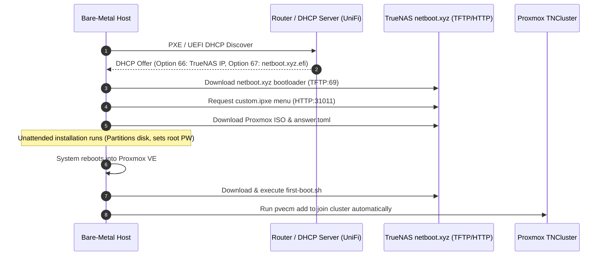

# 🌐 Automated PXE Network Boot Runbook

**Author:** Ryan Watson ([@thaleus1](https://github.com/thaleus1))  
**Repository:** [tn-homelab-howto](https://github.com/thaleus1/tn-homelab-howto)

This guide details how to configure unattended bare-metal operating system installations using **TrueNAS SCALE**, **`netboot.xyz`**, and **Proxmox automated answer files (`answer.toml`)**.

---

## 1. Architecture Flow



---

## 2. Setting Up `netboot.xyz` on TrueNAS SCALE

1. In TrueNAS SCALE, navigate to **Apps** → **Discover Apps**.
2. Install **`netboot.xyz`**.
3. Map persistent datasets for:
   * `/config` (holds custom menus like `custom.ipxe`)
   * `/assets` (holds Proxmox ISO files and answer templates)
4. Ensure ports `69/UDP` (TFTP) and HTTP asset server port (e.g. `31011` or `8080`) are reachable from your management VLAN.

---

## 3. Configuring Router DHCP (UniFi Example)

1. Open **UniFi Network Application** → **Settings** → **Networks**.
2. Select your **Management Network** (e.g., VLAN 1).
3. Scroll to **DHCP** → Switch DHCP Mode to **Manual**.
4. Enable **Network Boot**:
   * **Server IP**: IP address of your TrueNAS server.
   * **Filename**: `netboot.xyz.efi` (for UEFI) or `netboot.xyz.kpxe` (for legacy BIOS).
5. Save changes.

---

## 4. Preparing Answer Files (`answer.toml`)

Proxmox VE 8.2+ supports zero-touch installations using TOML answer files. Sample templates are provided in [`infra/pxe/answer.toml.example`](../infra/pxe/answer.toml.example).

### Generating a Secure Root Password Hash
Do **not** commit plaintext passwords. Generate a salted hash on Linux or macOS:

```bash
# Generate a SHA-512 password hash
openssl passwd -6 "YourSecureRootPassword"

# Or generate a yescrypt hash on Debian/Ubuntu
mkpasswd -m yescrypt "YourSecureRootPassword"
```

Paste the resulting hash into `answer.toml.example` under `root-password-hashed`.

---

## 5. First-Boot Cluster Join Hook

After the installation finishes and the node reboots, `first-boot.sh` runs automatically:
1. Verifies network connectivity to the cluster leader.
2. Executes `pvecm add <LEADER_IP> --link0 <NEW_NODE_IP> --fingerprint <CLUSTER_FINGERPRINT>`.
3. Mounts shared cluster backup storage (`TNBackups` NFS).
4. Verifies cluster quorum before signaling success.
