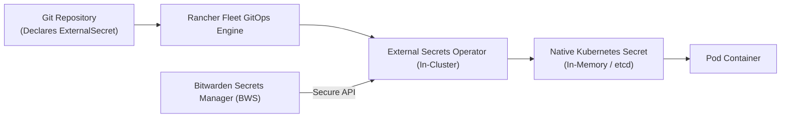

# 🔐 Secrets Management: Bitwarden Secrets Manager & ESO

**Author:** Ryan Watson ([@thaleus1](https://github.com/thaleus1))  
**Repository:** [tn-homelab-howto](https://github.com/thaleus1/tn-homelab-howto)

This guide documents how to implement declarative, zero-leak secrets management using **External Secrets Operator (ESO)** and **Bitwarden Secrets Manager (BWS)** in a GitOps environment.

---

## 1. Why Bitwarden Secrets Manager + ESO?

* **Zero Committed Secrets**: Secrets are never written to Git repositories, eliminating accidental credential leaks.
* **Central Rotation**: Changing an API key or database password in the Bitwarden Web UI automatically propagates into Kubernetes Secrets within 1 hour.
* **Separation of Privileges**: Developers and GitOps engines declare *what* secret key to pull (`remoteRef.key`), without having permission to view the value during commit or code review.



---

## 2. Step 1: Deploy External Secrets Operator

Install ESO via Helm:
```bash
helm repo add external-secrets https://charts.external-secrets.io
helm repo update

helm install external-secrets \
  external-secrets/external-secrets \
  -n external-secrets \
  --create-namespace \
  -f platform/external-secrets/values.yaml
```

---

## 3. Step 2: Configure Bitwarden Access Token

1. In the **Bitwarden Secrets Manager** web console, create a Machine Account and generate an Access Token.
2. Store the token in the `external-secrets` namespace:
   ```bash
   kubectl create secret generic bitwarden-access-token \
     -n external-secrets \
     --from-literal=token="<YOUR_BITWARDEN_ACCESS_TOKEN>"
   ```

---

## 4. Step 3: Deploy ClusterSecretStore

Apply the cluster-wide secret store template located in [`platform/external-secrets/cluster-secret-store.yaml`](../platform/external-secrets/cluster-secret-store.yaml):

```yaml
apiVersion: external-secrets.io/v1
kind: ClusterSecretStore
metadata:
  name: bitwarden-secretsmanager
spec:
  provider:
    bitwardensecretsmanager:
      organizationID: "<YOUR_BITWARDEN_ORGANIZATION_ID>"
      projectID: "<YOUR_BITWARDEN_PROJECT_ID>"
      apiURL: https://api.bitwarden.com
      identityURL: https://identity.bitwarden.com
      auth:
        secretRef:
          credentials:
            name: bitwarden-access-token
            namespace: external-secrets
            key: token
```

---

## 5. Step 4: Synchronizing Secrets to Workloads

Any application can now synchronize credentials dynamically. Example for an SMB share:

```yaml
apiVersion: external-secrets.io/v1
kind: ExternalSecret
metadata:
  name: smbcreds
  namespace: default
spec:
  refreshInterval: "1h"
  secretStoreRef:
    name: bitwarden-secretsmanager
    kind: ClusterSecretStore
  target:
    name: smbcreds
    creationPolicy: Owner
  data:
    - secretKey: username
      remoteRef:
        key: "smb-username"
    - secretKey: password
      remoteRef:
        key: "smb-password"
```
